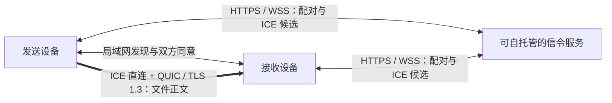

<h1 align="center">LinkSend</h1>

<p align="center">
  <strong>让文件在你的设备之间直接传输。</strong><br>
  Windows 与 macOS 桌面端 · 局域网发现 · 跨网络 P2P · 可自托管信令
</p>

<p align="center">
  <a href="https://github.com/Wen5555/LinkSend/releases"></a>
  <a href="https://github.com/Wen5555/LinkSend/actions/workflows/core.yml"></a>
  <a href="https://github.com/Wen5555/LinkSend/actions/workflows/desktop.yml"></a>
  <a href="LICENSE"></a>
</p>

<p align="center">
  <a href="#下载与安装">下载与安装</a> ·
  <a href="#开始传输">开始传输</a> ·
  <a href="#工作原理">工作原理</a> ·
  <a href="#开发与构建">开发与构建</a> ·
  <a href="#文档导航">文档</a> ·
  <a href="https://github.com/Wen5555/LinkSend/issues">反馈问题</a>
</p>

LinkSend 是一个开源点对点文件传输工具，适合在自己的电脑之间、与附近设备或跨网络分享文件。它使用 Go 网络内核和 Wails 3 桌面界面，通过设备发现与配对建立信任，再通过认证、加密的 QUIC 连接传输文件。

**文件正文由两端设备直接传输，信令服务只负责协调连接。** 同一局域网内可发现并添加附近设备；跨网络时使用可自托管的信令服务和 ICE 建立直连。

> [!NOTE]
> LinkSend 目前处于测试预发布阶段。最新公开版本是 [v0.5.0-desktop-preview.2](https://github.com/Wen5555/LinkSend/releases/tag/v0.5.0-desktop-preview.2)，主分支包含其后的修复。下载包与当前源码的能力、测试结果需分别查看，详见[当前状态与限制](#当前状态与限制)。

## 主要功能

- **文件与目录传输**：支持单文件、多文件、目录及空目录，提供发送草稿、顺序队列与任务记录。
- **多设备分发（开发候选）**：同一草稿选择2–16台已配对设备，原子加入独立目标队列，逐个发送并单独处理等待、取消与重试；当前公开包不据此升级能力，证据见[阶段记录](docs/evidence/DESKTOP-AE-DEVICE-BATCHES.md)。
- **附近设备与跨网络配对**：局域网内发现设备并经双方同意添加；跨网络使用一次性配对码建立设备组。
- **加密与完整性校验**：使用 Ed25519 设备身份、TLS 1.3 双向认证及公钥固定，使用 BLAKE3 校验文件块和完整文件。
- **暂停与恢复**：支持暂停、取消及应用重启后的恢复；恢复时重新验证暂存数据，只请求缺失或损坏的块。
- **安全接收**：接收前确认内容与保存目录，支持高级选收；默认同名保留两份，完整校验后才提交文件。
- **设备偏好与后台接收**：支持设备别名、固定、专属接收目录及按设备免确认；应用打开时保持接收能力，也可选择后台常驻。

自动剪贴板和原生系统共享的源码、验证结果与未完成项见[验收记录](docs/evidence/DESKTOP-E5-ACCEPTANCE.md)，其平台边界列在下方。

## 下载与安装

以下链接对应 **v0.5.0-desktop-preview.2**。其他版本见 [Releases](https://github.com/Wen5555/LinkSend/releases)。

| 平台 | 架构 | 下载 | 说明 |
| --- | --- | --- | --- |
| Windows | x64 / amd64 | [便携 ZIP][windows-zip] · [安装程序][windows-installer] | 运行桌面端需要 WebView2 Runtime |
| macOS | Apple Silicon / arm64 | [DMG][macos-arm64] | 最低 macOS 13 |
| macOS | Intel / amd64 | [DMG][macos-amd64] | 最低 macOS 13；最低版本与 Intel 实机验收仍有缺项 |

发行页同时提供 [SHA256SUMS.txt][release-checksums] 和 [RELEASE-MANIFEST.json][release-manifest]，用于核对包哈希与源码来源。此预发布包来自提交 `0229cbf`；主分支的后续修复未重新发布为该包。

Windows 包尚未进行代码签名；macOS 包采用 ad-hoc 签名，尚未公证。两端可能出现系统安全提示，安装与运行边界见[交付记录](docs/evidence/DESKTOP-E5-DELIVERY.md)。

Linux 当前用于信令服务与 CLI；Linux 桌面端属于尽力支持范围，本次预发布没有提供 Linux 桌面安装包。

## 开始传输

1. **打开两端应用**，在“设置 → 文件接收”中选择接收目录。
2. **添加目标设备**，根据网络环境选择下面的方式。
3. **选择文件或文件夹**，在“传输”页选中目标设备并发送，也可以拖放文件到应用。
4. **接收方确认**内容与保存位置。完成后可在“记录”中查看结果；默认同名文件保留两份。

### 同一局域网

在“设备 → 添加附近设备”中选择对方，并在对端确认添加。设备未出现时，可输入对方的局域网 IPv4 地址，只探测这一台设备。局域网添加与直连可以独立于服务端在线状态工作。

### 不同网络

两端在“设置 → 网络与发现”中配置同一个 HTTPS 信令服务。首次使用时，一端在“设备”页初始化本机设备组并生成配对码，另一端输入配对码完成配对。配对码采用 `ABCD-EFGH` 格式，10 分钟有效，单次使用。

跨网络传输还需要网络允许 UDP 直连，并按部署配置 STUN。配对成功或设备在线只表示控制面状态；真正传输仍需完成 ICE 与 QUIC 握手。

开发候选提供“设备 → 服务重建后重新连接”：确认恢复后选择新建本机设备组或加入另一台设备的新组。它保留身份、文件、历史、设置和有效局域网关系，隔离旧组任务；新关系的免确认和剪贴板权限需重新开启。网络暂时失败不会自动重置。请求可能已送达时可暂停，重启后继续核对实际结果；不会重放已消费的邀请码。此入口的准确包原生验收状态见[本轮证据](docs/evidence/DESKTOP-AE-MEMBERSHIP-RECOVERY.md)。

开发候选在发送页提供目录预设：默认发送完整内容，可选择“源码目录”排除依赖与构建目录，也可添加有限相对路径规则；预览包含/排除数量、体积与条目，随时恢复完整发送。已入队任务和重启恢复沿用各自保存的规则；预览不冻结源文件，派发仍会核对变化。实际验证与包级状态见[N1证据](docs/evidence/DESKTOP-AE-SOURCE-SELECTION.md)。

应用打开后会等待接收请求，无需单独启动“接收任务”。可在已配对设备的偏好中启用免确认接收；这一设置仍保留身份、路径和内容校验。

## 工作原理

LinkSend 将发现、配对与连接协调交给控制面，将文件读写与传输交给 Go 数据面。



- **局域网发现**使用签名组播、定向广播和受限单播；发现本身不授予信任。
- **连接建立**使用 Pion ICE 与 quic-go，共用 UDP socket；STUN 提供地址发现，连接检查决定能否直连。
- **数据传输**使用已认证的 QUIC 会话。文件正文不经过信令服务、HTTP 上传、JavaScript IPC 或第三方存储。
- **接收落盘**先写入隔离暂存区，验证块与完整内容，再按接收计划安全提交。恢复时重新哈希暂存数据。

首次跨网络配对依赖信令服务返回正确的成员公钥；后续连接固定并校验对端公钥。完整信任模型见[安全说明](docs/SECURITY.md)，协议和模块边界见[协议文档](docs/PROTOCOL.md)与[架构文档](docs/ARCHITECTURE.md)。

## 当前状态与限制

当前源码产品版本为 **0.5.0**，文件数据协议保持 **V1**。版本号、源码测试、发行包核验与实机验收是不同层次的证据。

| 能力 | 当前边界 |
| --- | --- |
| Windows / macOS 文件传输 | 已有局域网实机与恢复记录，结论绑定具体提交和包；不自动继承到后续版本 |
| 跨 NAT P2P | 已有受控双 NAT、固定 UDP 映射的通过记录；仅 MASQUERADE 的场景曾返回 `CHECK_TIMEOUT`，更多真实 NAT 类型仍待验证 |
| 中继 | 未实现文件中继或 TURN allocation，能力固定为 `relay=false`；直连失败会报告错误 |
| 自动剪贴板 | 已实现权限、租约和认证 QUIC 路径；总开关及各设备、方向、格式权限默认关闭，物理 Windows ↔ macOS 系统剪贴板闭环仍未通过验收 |
| 原生系统共享 | Windows Share Target / macOS Share Extension 有源码及交接自测；正式签名、安装与系统激活验收仍有缺项 |
| 网络与系统兼容 | 公网 IPv6、物理网络切换与睡眠唤醒、完整安装/卸载、最低 macOS 版本及部分原生交互矩阵仍待验证 |

UDP 被阻断或 NAT 映射、过滤不允许打洞时，跨网络直连可能失败。当前不提供移动端、浏览器客户端或自动端口映射。

详细结果见[验收矩阵](docs/ACCEPTANCE.md)、[桌面验收记录](docs/evidence/DESKTOP-E5-ACCEPTANCE.md)和[实现进度](docs/PROGRESS.md)；尚未完成的工作保留在[桌面体验 TODO](docs/DESKTOP-EXPERIENCE-TODO.md)。

## 常见问题

**附近设备没有出现怎么办？**

先确认两端应用已打开、使用同一可互通局域网。访客网络、校园网隔离或组播过滤可能影响发现；可以使用单个局域网 IPv4 地址定向探测，或经信令服务配对。网络本身的隔离仍可能阻止直连。

**设备在线，为什么传输仍然失败？**

在线状态来自信令，文件连接还需要通过 ICE 检查和 QUIC 认证。查看任务中的失败阶段、错误码及诊断，核对网卡选择、UDP 可达性和 STUN 配置；更多步骤见[网络验证文档](docs/LAN-VALIDATION.md)。

**信令服务能看到我的文件吗？**

信令服务处理成员、在线状态和连接协商元数据，文件正文只经过两端之间的加密 QUIC 连接。首次跨网络配对仍依赖可信信令服务，部署和信任边界见[安全说明](docs/SECURITY.md)。

**中断后会从头重传吗？**

恢复会重新认证设备、核对源内容和接收计划，并校验暂存块，只请求缺失或损坏的块。源文件、身份或恢复绑定发生变化时会明确拒绝恢复；正常退出时可保留恢复状态。

## 开发与构建

仓库包含两个独立 Go 模块：根模块负责网络内核、CLI 与信令服务，`apps/desktop` 负责 Wails 与原生桌面依赖。只运行根目录的 `go test ./...` 不会测试桌面模块。

| 工具 | 项目锁定版本 | 用途 |
| --- | --- | --- |
| Go | 1.27.1 | 核心、CLI、信令与桌面后端 |
| Node.js | 24.21.0 | 桌面前端 |
| pnpm | 12.4.1 | 前端依赖与锁文件 |
| Wails | 3.0.0-beta.18 | 桌面开发与打包 |

### 运行核心演示

核心命令不依赖 Node.js、Wails 或桌面系统库。在安装 Go 后运行：

```powershell
git clone https://github.com/Wen5555/LinkSend.git
Set-Location LinkSend

go run ./cmd/linksend --version
go run ./cmd/rendezvous --version
go run ./cmd/devtool demo-local
```

`demo-local` 自动启动隔离的本机信令与两端身份，执行真实 ICE、TLS 1.3、QUIC 和文件校验。它只证明 loopback 直连，不能替代局域网或跨 NAT 验收。

### 启动桌面开发环境

安装上表工具及平台原生依赖，并确保 `wails3` 在 `PATH` 中。从仓库根目录运行：

```powershell
go install github.com/wailsapp/wails/v3/cmd/wails3@v3.0.0-beta.18

Set-Location apps/desktop/frontend
pnpm install --frozen-lockfile
Set-Location ..
wails3 dev -config ./build/config.yml
```

检查需覆盖两个 Go 模块及 `GOWORK=off` 独立模式，前端需运行 typecheck、lint、test 和 build。完整命令见[开发指南](docs/DEVELOPMENT.md)与[测试指南](docs/TESTING.md)，macOS 打包见[构建说明](docs/BUILD-MACOS.md)。

### 自托管信令服务

仓库提供[服务端配置示例](configs/server.example.toml)、[Docker Compose](deploy/compose.yml)、[Caddy 配置](deploy/Caddyfile)及 [coturn STUN-only 配置](deploy/coturn/stun-only.conf)。部署需要配置 HTTPS/WSS、持久化数据库和高熵 bootstrap 令牌；STUN-only 配置不提供文件中继。

可结合[已有部署记录](docs/DEPLOY-HK.md)和[安全说明](docs/SECURITY.md)核对自己的域名、证书与配置。历史环境中的路径与参数需按实际部署调整。

## 文档导航

| 你想了解什么 | 文档 |
| --- | --- |
| 产品范围与实现要求 | [SPEC](docs/SPEC.md) |
| 模块、信任与数据流 | [ARCHITECTURE](docs/ARCHITECTURE.md) · [PROTOCOL](docs/PROTOCOL.md) · [SECURITY](docs/SECURITY.md) |
| 本地开发与测试 | [DEVELOPMENT](docs/DEVELOPMENT.md) · [TESTING](docs/TESTING.md) |
| 已验证能力与已知缺项 | [ACCEPTANCE](docs/ACCEPTANCE.md) · [桌面验收](docs/evidence/DESKTOP-E5-ACCEPTANCE.md) |
| 版本、包来源与实施记录 | [桌面交付](docs/evidence/DESKTOP-E5-DELIVERY.md) · [PROGRESS](docs/PROGRESS.md) |
| 局域网与跨 NAT 验证 | [LAN-VALIDATION](docs/LAN-VALIDATION.md) · [STAGE2B](docs/STAGE2B.md) |
| 后续工作 | [桌面体验 TODO](docs/DESKTOP-EXPERIENCE-TODO.md) · [ROADMAP](docs/ROADMAP.md) |

## 参与贡献

欢迎通过 [Issues](https://github.com/Wen5555/LinkSend/issues) 报告问题或提出建议，通过 [Pull Requests](https://github.com/Wen5555/LinkSend/pulls) 提交改进。

报告问题时请提供系统与架构、版本或源码提交、复现步骤、预期与实际结果；连接问题请附失败阶段、稳定错误码与脱敏诊断。日志中请移除令牌、私钥、文件正文和敏感路径。

修改前请阅读 [AGENTS.md](AGENTS.md)、[SPEC](docs/SPEC.md)及[实现进度](docs/PROGRESS.md)。协议变化需同步文档与兼容、安全测试；验证记录应注明实际环境与未运行项。

## 许可证与致谢

LinkSend 采用 [Apache License 2.0](LICENSE)。

网络与桌面能力建立在 [Pion ICE](https://github.com/pion/ice)、[quic-go](https://github.com/quic-go/quic-go)、[Wails](https://github.com/wailsapp/wails) 和 [BLAKE3 Go 实现](https://github.com/zeebo/blake3) 等开源项目之上。

[windows-zip]: https://github.com/Wen5555/LinkSend/releases/download/v0.5.0-desktop-preview.2/LinkSend-v0.5.0-windows-amd64-0229cbf3e8373c544431102ed904c4a19ed02dc4.zip
[windows-installer]: https://github.com/Wen5555/LinkSend/releases/download/v0.5.0-desktop-preview.2/LinkSend-v0.5.0-windows-amd64-installer-0229cbf3e8373c544431102ed904c4a19ed02dc4.exe
[macos-arm64]: https://github.com/Wen5555/LinkSend/releases/download/v0.5.0-desktop-preview.2/LinkSend-v0.5.0-macos-arm64-0229cbf3e8373c544431102ed904c4a19ed02dc4.dmg
[macos-amd64]: https://github.com/Wen5555/LinkSend/releases/download/v0.5.0-desktop-preview.2/LinkSend-v0.5.0-macos-amd64-0229cbf3e8373c544431102ed904c4a19ed02dc4.dmg
[release-checksums]: https://github.com/Wen5555/LinkSend/releases/download/v0.5.0-desktop-preview.2/SHA256SUMS.txt
[release-manifest]: https://github.com/Wen5555/LinkSend/releases/download/v0.5.0-desktop-preview.2/RELEASE-MANIFEST.json
